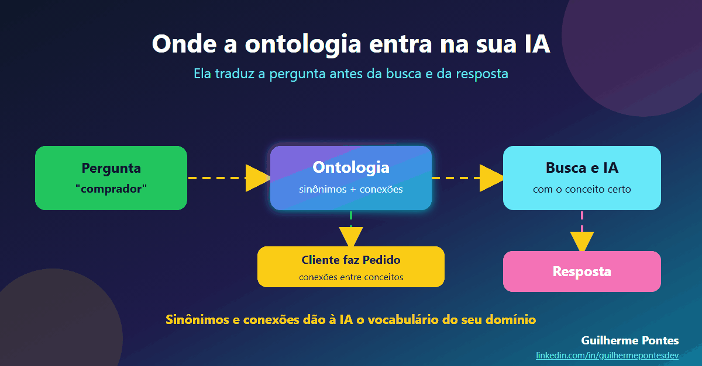

# Ontologia



Vocabulário de domínio em C# com **conceitos**, **sinônimos** e **conexões**. Ele traduz o jeito como as pessoas falam ("comprador", "tomador", "consumidor") para o conceito que o sistema conhece ("Cliente") e mostra como os conceitos se relacionam.

Sem dependências externas. Feito em .NET 10.

## Conceitos

- **Conceito:** uma entidade do domínio, como `Cliente`, `Pedido` ou `Produto`.
- **Sinônimo:** outro nome para o mesmo conceito. `comprador` e `tomador` são sinônimos de `Cliente`.
- **Conexão:** uma relação direcionada entre dois conceitos, com rótulo. `Cliente faz Pedido`.

## Uso

```csharp
using Ontologia;

var vocabulario = new Vocabulario()
    .Adicionar("Cliente", "comprador", "tomador", "consumidor")
    .Adicionar("Pedido", "compra", "ordem", "pedidos")
    .Adicionar("Produto", "item", "mercadoria", "itens")
    .Conectar("Cliente", "faz", "Pedido")
    .Conectar("Pedido", "contém", "Produto");
```

### Resolver um termo

Devolve o conceito canônico para um nome ou sinônimo, ou `null` se não existir.

```csharp
vocabulario.Resolver("comprador");   // "Cliente"
vocabulario.Resolver("MERCADORIA");  // "Produto"  (sem diferença de maiúsculas ou acentos)
vocabulario.Resolver("fornecedor");  // null
```

### Ver as conexões de um conceito

```csharp
foreach (var (direcao, relacao, outro) in vocabulario.Relacionados("Pedido"))
    Console.WriteLine($"{direcao} {relacao} {outro}");

// → contém Produto
// ← faz Cliente
```

`→` indica conexões que saem do conceito, e `←` indica as que chegam nele.

### Encontrar conceitos em um texto

```csharp
vocabulario.ConceitosNoTexto("quais pedidos do comprador?");
// ["Pedido", "Cliente"]

vocabulario.ConceitosNoTexto("o item da compra ainda está em estoque?");
// ["Produto", "Pedido"]
```

### Listar os sinônimos de um conceito

```csharp
vocabulario.Sinonimos("Cliente");   // ["comprador", "tomador", "consumidor"]
```

## Exemplo executável

```powershell
dotnet run
```

Saída:

```
1) Sinônimos resolvidos para o conceito
   comprador -> Cliente
   Tomador -> Cliente
   mercadoria -> Produto
   pedido -> Pedido

2) Conexões de um conceito
   → contém Produto
   ← faz Cliente

3) Conceitos citados em perguntas
   "quais pedidos do comprador?" -> Pedido, Cliente
   "o item da compra ainda está em estoque?" -> Produto, Pedido
```

## Benefícios

- **Entende sinônimos:** "comprador", "tomador" e "consumidor" apontam para o mesmo conceito, então uma pergunta com qualquer um deles encontra os mesmos dados.
- **Conecta conceitos:** as conexões mostram como as informações se ligam, nos dois sentidos.
- **Interpreta perguntas:** antes de uma busca ou de uma resposta de IA, a pergunta vira os conceitos que ela cita.
- **Sem dependências:** é C# puro, fácil de testar e de levar para outro projeto.
- **Cresce aos poucos:** basta cadastrar mais conceitos e conexões, sem mudar a classe.

## Limitações

- A busca é palavra por palavra. Conceitos com nome composto, como "forma de pagamento", não são encontrados sozinhos.
- Plurais precisam ser cadastrados como sinônimos, como `pedidos` e `itens` no exemplo.
- Não há carregamento de arquivo: o vocabulário é montado no código.

## Estrutura

| Arquivo | Conteúdo |
|---|---|
| `Vocabulario.cs` | Classe principal: conceitos, sinônimos, conexões e busca. |
| `Program.cs` | Exemplo executável com os casos acima. |
| `docs/VISAO.md` | Visão do projeto, sem termos técnicos. |
| `docs/SDD.md` | Desenho técnico, decisões e riscos. |
| `CLAUDE.md` | Instruções para o Claude trabalhar no repositório. |

## Próximos passos possíveis

- Extrair uma interface `IVocabulario` para injeção de dependência.
- Carregar o vocabulário de um arquivo JSON.
- Suportar termos com mais de uma palavra.
